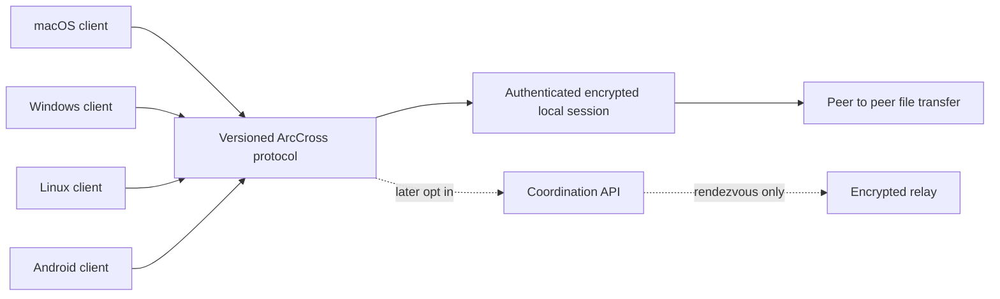

# ArcCross Technical Requirements Document

**Status:** Proposed architecture for review  
**Scope:** Client architecture, local discovery and transfer, security boundaries, future service, build, and interoperability  
**Important:** These are recommendations; the supplied context does not confirm an implementation or final stack.

## 1. Architecture summary

ArcCross should use native clients where operating-system integration matters and one versioned protocol for interoperable pairing and transfer. The first release path should run directly between trusted devices on the local network. A backend is unnecessary for local pairing and transfer; design its interfaces only when the team reaches hosted connectivity.

The discovery layer finds a possible peer. Pairing and cryptographic identity establish trust. A later relay may forward encrypted bytes but must not receive file or clipboard plaintext.

## 2. Proposed technology decisions

| Area | Recommendation | Status and rationale |
|---|---|---|
| macOS client | Swift and SwiftUI | Proposed baseline from the project context. Keep networking, permission prompts, secure storage, and UI in platform-appropriate layers. |
| Android client | Kotlin and Jetpack Compose | Proposed baseline from the project context. Android’s official docs describe Compose as its modern native UI toolkit; validate against chosen minimum versions. |
| Windows client | C# with WinUI 3 and Windows App SDK | Proposed baseline from the project context. Microsoft currently recommends WinUI 3 for new native Windows desktop apps; verify version and deployment requirements before locking support. |
| Linux client | Select after an M2 spike | Open decision. Compare GTK and Qt or another suitable client framework against packaging, desktop integration, team skill, and maintenance cost. Choose one supported distribution baseline before claiming Linux support. |
| Shared protocol encoding | Start with versioned JSON messages and a published schema | Recommendation, not confirmed. JSON is easy to inspect during early interoperability work. Revisit Protocol Buffers only if measured size/performance or compatibility needs justify it. |
| Local discovery | Use DNS-SD/mDNS through supported OS APIs; retain QR/manual fallback | Recommendation. Android NSD supports DNS-SD discovery on local networks. Apple documents local-network privacy controls for relevant platforms, so discovery permission and signed-build behavior must be tested. |
| Session transport | Authenticated encrypted stream using vetted platform TLS libraries | Recommendation. Device identity must be checked independently of discovery. The team must validate minimum OS support and TLS configuration during M0; do not write custom cryptography. |
| Local metadata | SQLite or platform-appropriate local database; keep secrets in OS secure storage | Recommendation. Store device/transfer metadata locally. Never place private keys or pairing secrets in ordinary database fields. |
| Hosted service | No service for M0–M2. For M4, a small TypeScript API with PostgreSQL is a proposed starting point. | Backend language/database are proposed in the source context; provider, framework, operations owner, and deployment remain open. Do not create service infrastructure before M4 approval. |
| CI and release | Per-client build checks, protocol fixture tests, integration matrix, dependency review, signed release artifacts where required | Recommendation. Select CI provider after repository creation and team access review. |

## 3. Client boundaries

Each client should separate these responsibilities:

- **Presentation:** platform-specific screens, navigation, permission explanations, and accessibility.
- **Application services:** pairing, device management, file selection, transfer lifecycle, clipboard send, and activity handoff.
- **Protocol adapter:** versioned message encoding/decoding, capability negotiation, and error mapping.
- **Transport/discovery:** local discovery, authenticated session establishment, stream management, and reconnection.
- **Persistence:** local device records, transfer history, user preferences, and later optional clipboard history.
- **Secure storage:** private identity keys and sensitive credentials using OS key stores.

The clients may differ in UI and OS integration. They must not independently reinterpret protocol semantics.

## 4. Protocol requirements

### Envelope

Every application message should carry a protocol version, message identifier, type, sender device identifier, and typed payload. Session authentication and encryption belong to the transport/security layer; a JSON field that claims “encrypted” is not a security control.

### Initial message types

- `pairing.request`, `pairing.approve`, `pairing.reject`, `pairing.complete`
- `device.capabilities`, `device.revoke`, `device.status`
- `transfer.offer`, `transfer.accept`, `transfer.reject`
- `transfer.progress`, `transfer.complete`, `transfer.cancel`, `transfer.error`
- Later: `clipboard.send`, `activity.offer`, `relay.rendezvous`

### Compatibility rules

- Version the protocol separately from client release versions.
- Define required and optional fields, size limits, error codes, and capability negotiation.
- Keep golden test fixtures for valid, invalid, old-version, and boundary messages.
- Reject malformed and oversized input safely; never trust filenames or paths received from peers.
- Discovery advertises only what a nearby client needs to connect; it does not publish file names, clipboard text, or private identity material.

## 5. Pairing and trust model

**Recommendation for M0:** use a QR code or short verification code to bind the user-approved devices. The code should prove that both users are looking at the same pairing attempt; it must not be a long-term secret.

1. A device creates an expiring pairing request and ephemeral challenge.
2. The peer displays the matching confirmation details.
3. The user approves on both sides or confirms the comparison on the receiving device.
4. The clients exchange device identity information over an authenticated encrypted channel.
5. The clients store only the trusted peer’s public identity and necessary metadata.
6. Revocation removes the trust relationship and blocks new sessions.

The exact protocol, key rotation, recovery, and multi-account behavior remain M0/M4 decisions. Define a threat model before implementing beyond a contained proof.

## 6. Local transfer lifecycle

1. Sender selects files and a trusted recipient.
2. Sender sends a transfer offer with metadata and agreed limits.
3. Receiver accepts or applies a user-configured trusted-device policy.
4. Sender streams encrypted content in bounded chunks.
5. Receiver writes to a temporary file, validates size and digest, then moves it into the selected destination.
6. Both sides record completion or a stable error code.
7. Cancellation, interruption, and retry behavior are explicit; partial data is removed or retained only under a documented resume design.

Do not auto-open received files. Apply safe path handling and agreed maximum file/transfer sizes.

## 7. Discovery and platform constraints

Use the same discovery semantics across clients, but adapt to each OS API. Discovery must recover from a denied permission, network change, VPN, guest Wi-Fi isolation, firewall, and device sleep. Provide QR/manual pairing as a fallback to discovery.

Platform research to complete before implementation hardens:

- Android Network Service Discovery (NSD) uses DNS-Based Service Discovery for local services.
- Apple documents Local Network privacy prompts and behavior for local-network and Bonjour operations. Test permission states on physical hardware and signed builds for the chosen macOS versions.
- Windows firewall prompts and local discovery behavior must be validated against the chosen deployment model.
- Linux firewall, system service, and packaging behavior depend on the framework/distribution selected for M2.

## 8. Security and privacy requirements

- Use reviewed TLS implementations and a documented device authentication scheme.
- Keep private keys out of logs, telemetry, SQLite, crash reports, and cloud databases.
- Reject unpaired, revoked, malformed, replayed, and unauthorized transfer requests.
- Verify file integrity; use a standard digest such as SHA-256 for content verification.
- Avoid exposing directory paths, clipboard contents, and file contents in logs.
- Make clipboard history and hosted connectivity opt-in; define retention and deletion.
- For a future relay, encrypt end to end before relay entry and authorize each rendezvous with expiring, scoped tokens.
- Update the threat model before clipboard history, accounts, push, relay, notifications, or remote input.

## 9. Future service boundary

The local MVP does not need an API, account database, or relay. If M4 is accepted, the service should coordinate identity/device registration and optional rendezvous. It should not become the default path for local files.

Proposed service responsibilities:

- authenticate account sessions through an approved identity approach;
- associate public device identities with an account;
- register and revoke push endpoints;
- issue short-lived rendezvous records for relay negotiation;
- enforce authorization, expiry, rate limits, and account/device deletion.

Service responsibilities explicitly exclude storing file payloads or clipboard contents by default.

## 10. Testing and observability

- Protocol unit tests and golden fixtures.
- Client pair conformance tests for every claimed platform pair.
- Physical-device tests for local discovery, permissions, sleep/resume, network changes, and large agreed file sizes.
- Negative security tests for rejected pairing, revoked devices, malformed messages, expired tokens, and corrupted file content.
- Use privacy-safe logs with stable error codes; do not log user content or secrets.
- Establish transfer-speed and failure baselines on real networks before writing performance targets.

## 11. Technical decisions to record

| Decision | Owner | Due before |
|---|---|---|
| Pilot desktop/Android pair and minimum supported OS versions | All; Member B/C own device validation | M0 start |
| JSON schema, message versioning, and error registry | Member A | M1 implementation |
| Pairing code verification, key lifecycle, and revocation | Member A with B/C review | M0 proof beyond hello message |
| Local discovery service type and transport details | Member A with client owners | M0 transfer proof |
| Linux framework and distribution | Member B | M2 |
| API framework, hosting provider, data retention, and operating owner | Member A/C | M4 |
| Account-free pairing and public release feature set | Product team | Before public beta |

## 12. Official references

- [SwiftUI documentation](https://developer.apple.com/documentation/swiftui/)
- [Jetpack Compose architecture](https://developer.android.com/develop/ui/compose/layering)
- [WinUI 3 documentation](https://learn.microsoft.com/en-us/windows/apps/winui)
- [Android Network Service Discovery](https://developer.android.com/develop/connectivity/wifi/use-nsd)
- [Apple TN3179 local-network privacy](https://developer.apple.com/documentation/technotes/tn3179-understanding-local-network-privacy)
- [PostgreSQL documentation](https://www.postgresql.org/docs/)
- [Android background execution limits](https://developer.android.com/about/versions/oreo/background)
- [Android notification listener API](https://developer.android.com/reference/android/service/notification/NotificationListenerService)
- [Apple ScreenCaptureKit](https://developer.apple.com/documentation/screencapturekit/capturing-screen-content-in-macos)

Check the official documentation again when selecting supported OS versions or APIs. This list records current research examples; it is not a substitute for platform testing.
