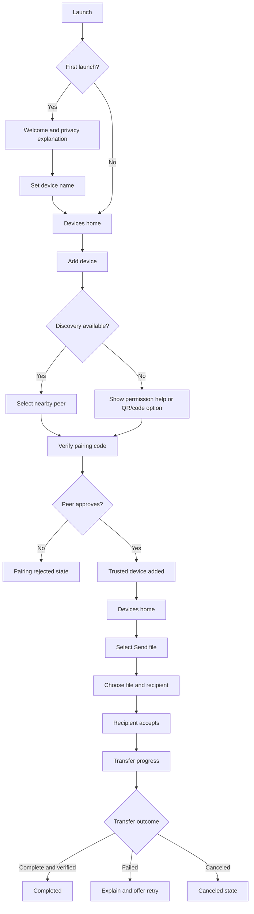

# ArcCross App Flow
> New to this topic? Read the [Beginner Team Guide](BEGINNER_TEAM_GUIDE.md) first. This document includes a plain-language explanation and notes about work that needs human review.

**Status:** Proposed navigation and user journeys  
**Primary release:** Local file sharing on paired desktop and Android devices  
**Later capabilities:** Clipboard, handoff, hosted connectivity, notification access, richer status, remote Mac interaction

## 1. Navigation model

Keep the first release small. Use the same top-level concepts on desktop and Android, while adapting controls to each platform's conventions.

### Primary navigation

- **Devices:** paired devices, local discovery, pairing action, online/last-seen status.
- **Transfers:** active, completed, failed, and canceled transfers.
- **Settings:** permissions, privacy, receive behavior, diagnostics, and about.

On desktop, use a persistent sidebar with a main content pane. On Android, use a simple bottom navigation bar or top-level navigation pattern chosen in the prototype. Pairing and transfer details may open as dialogs/sheets where the platform convention fits.

## 2. Top-level flow

## 3. First-run journey

1. Show a short explanation: ArcCross finds and connects nearby devices. Local-network access is used for device discovery and transfer.
2. Let the user name the device. Use a sensible local default but allow editing.
3. Explain the local-network permission immediately before the first operation that needs it.
4. If the user denies access, keep the app usable and show clear steps to enable it later.
5. Land on Devices with one primary action: **Add device**.
6. Show the current device as “This device” with platform and connection status.

Do not ask for notification, clipboard, screen-recording, or accessibility permission during basic onboarding. Ask only when the user starts the feature that needs it in a later release.

## 4. Pairing journey

### Initiate pairing

1. User selects **Add device**.
2. App searches for compatible local peers. Show progress and a manual QR/code option.
3. User selects a peer. Display device name, platform, and a short verification code or QR.
4. The other device displays the same pairing request and requires user approval.
5. Both devices confirm pairing. Show the newly trusted device on the Devices screen.

### Incoming request

- Show the requesting device name and platform.
- Ask the user to compare the short code or scan the QR.
- Provide clear **Approve** and **Reject** actions.
- Expire a request after a brief, defined period and state that it expired.

### Rejected or failed request

- State that the device was not paired.
- Keep no trusted-device record for the rejected request.
- Provide **Try again** and **Use QR/code** actions where appropriate.
- Avoid errors that imply an unknown device is already trusted.

## 5. Send-file journey

1. User opens **Send file** from Devices or Transfers.
2. User selects one or more files using the operating-system picker.
3. User chooses a trusted destination device.
4. Show file names, approximate total size, destination, and the action to begin.
5. Receiver gets an incoming transfer prompt unless the user has explicitly configured a different trusted-device receive policy.
6. While transferring, show progress, bytes or percentage, current state, and **Cancel**.
7. On completion, show **Verified** and a destination action such as **Show in folder** or **Open location**. Do not automatically open the received file.
8. On interruption, explain what happened and offer **Retry**. Offer **Resume** only after resumable transfer behavior is implemented and tested.

## 6. Receive-file journey

1. A trusted device sends a transfer offer.
2. Show sender identity, file name, size, and receive/cancel choices.
3. Write to a temporary destination while transfer is active.
4. Verify integrity before presenting the final file.
5. If verification fails, remove or quarantine the incomplete file according to the security design, show a clear failure, and record a safe error code.
6. When complete, show the saved location and sender.

## 7. Device-management journey

From **Devices**, the user can:

- open device details;
- see platform, online/offline or last-seen state, and supported capabilities;
- see active transfers for that device;
- rename a local display label where supported;
- remove/revoke a device after a confirmation step.

A removed device must no longer initiate trusted sessions. Make the change visible immediately on both local UI and future reconnect attempts.

## 8. Failure and recovery paths

| Situation | User-facing state | Next action |
|---|---|---|
| Local-network access denied | Explain why discovery cannot run and how to change permission in system settings. | **Open settings** where supported; **Try again** |
| No devices found | Explain that devices must be paired/available on a compatible network. | **Scan again**, **Use QR/code**, **Check network** |
| Peer is offline | Keep device visible with last-seen time. | **Retry when online**, **Remove device** |
| Pairing code mismatch | Do not establish trust. | **Restart pairing** |
| Transfer rejected | Show recipient rejected the offer; do not retry automatically. | **Choose another device**, **Send again** |
| Connection drops | Mark transfer interrupted and clarify partial-file handling. | **Retry** or **Resume** only if supported |
| Integrity mismatch | Mark failed and never show as complete. | **Discard partial file**, **Retry** |
| Storage unavailable | State that the destination could not be written. | **Choose another location**, **Retry** |
| Device revoked | Show that trust was removed and require pairing again. | **Pair again** |

## 9. Later feature flows

### Explicit clipboard send

Select text/link in ArcCross or use a supported share action → choose paired device → preview content → send → recipient confirms or receives according to user settings → show sent/failed result. Clipboard history remains a separately opted-in feature with pause, clear, and retention controls.

### Hosted connectivity

User enables cross-network access in Settings → see a plain-language account/relay explanation → opt in and authenticate → register devices → show hosted status separately from local availability. If the service is unavailable, preserve local actions and state what cannot currently work.

### Notification forwarding

User opens the feature and initiates setup → app explains which notifications may be accessed and where they will appear → user grants OS permission → user can choose permitted sources and pause/revoke forwarding. Keep this off until explicitly enabled.

### Remote Mac access

User selects a separate remote-access feature → sees requested screen/input permissions and target device → approves on the Mac → active session indicator remains visible → user can disconnect immediately and revoke access. This is a later feature with its own security review.

## 10. Navigation states to design

- First-run, permission explanation, permission denied, and permission restored.
- Empty Devices screen, searching, results, no results, offline device, and paired device list.
- Incoming pairing, code mismatch, expired request, accepted and rejected states.
- Transfer queued, waiting for recipient, transferring, paused/interrupted, canceled, verified complete, failed, and retrying.
- No internet while local network is available; service unavailable in a later hosted release.
- Revoked device and failed reconnect.

## Beginner guide for this flow

Read the flow as “what the user sees next,” not as a promise that the networking code already exists. Each branch matters: a screen for permission denied, code mismatch, cancellation, or storage failure is part of the feature.

**Example:** “Add device → find nearby peer → compare code → approve” is not one button. Finding a peer only discovers it; comparing and approving is the trust step. If the code mismatches, stop pairing and keep the device untrusted.

When reviewing a flow, walk it with a teammate acting as the user. Try the happy path, then deliberately reject, deny a permission, disconnect Wi-Fi, cancel a transfer, and choose a destination without space. Never design a success screen that appears before file integrity verification.

The most sensitive screens are pairing approval, file receive approval/destination, permission prompts, revoke, clipboard consent, notification access, and remote-access consent. The team must keep these decisions explicit and test their decline/revoke paths. AI can suggest screen wording, but a member must confirm the wording matches what the code actually does.

For terms such as “discovery,” “trust,” “verified,” and “temporary file,” read the [Beginner Team Guide](BEGINNER_TEAM_GUIDE.md). The [UI/UX brief](ui_ux_design_brief.md) describes visual behavior; the [PRD](prd.md) defines the user-visible acceptance outcome.
