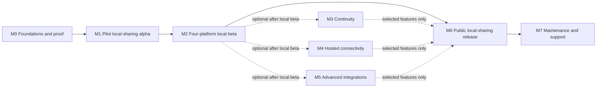

# ArcCross Team Roadmap and Equal Work Split
> New to this topic? Read the [Beginner Team Guide](BEGINNER_TEAM_GUIDE.md) first. This document includes a plain-language explanation and notes about work that needs human review.

**Status:** Working execution plan for the three-person team  
**Prepared:** 31 October 2026  
**Source of truth:** This file is the current ownership and sequencing plan. The PRD, TRD, App Flow, UI/UX brief, Backend Schema, and competitive brief remain the detailed product/technical references.  
**Decision status:** Product direction is established; the recommendations below need team approval before they become implementation decisions.

## 1. What the team is building

ArcCross will make local file sharing between macOS, Windows, Linux, and Android devices dependable and understandable. The product should explain why a device cannot be found or reached, offer a safe fallback, and recover from interrupted transfers. “Cross-platform file sharing” alone is not a gap: LocalSend already targets these systems. Reliability, pairing clarity, recovery, permission handling, and trustworthy releases are the product bet described in the competitive research brief.

The launch path is deliberately narrow:

1. Prove secure transfer between one available desktop and one Android device.
2. Expand the same behavior to all four target platforms.
3. Release the local-sharing product when the four-platform quality gate passes.
4. Add clipboard, hosted connectivity, notification forwarding, and remote Mac capabilities as separate projects after the local product is stable.

The current repository contains the specification pack and project-plan files. The inspected file list did not show application source code, so this plan includes repository setup and the first working implementation path.

## 2. Workshare rule

Equal means equal planned effort and equal accountability, not the same number of files or platform clients. The team has not provided member names, availability, or skills, so the roles below are provisional.

For each milestone, reserve **10 normalized effort points per member**. These points are planning weights, not hours. At sprint planning, break each work package into small tickets and re-estimate them together. If one member exceeds the other two by more than one point in a two-week sprint, move a backlog ticket or reduce scope before work starts. Recalibrate after Sprint 0 using the team’s actual skills and velocity.

**In plain words:** points are a way to compare effort, not a clock. A 3-point task should be larger than a 2-point task, but the team decides the actual effort after seeing the code and learning the tools. Example: Member B might need more time for a first Windows build than for a familiar UI fix; re-estimate together rather than hide the difficulty.

| Member | Primary lane | Owned paths after setup | Not owned by this member |
|---|---|---|---|
| **A — Core Systems** | Protocol, identity, discovery/transport contracts, security, shared fixtures; later hosted-service security contract. | `packages/protocol/`, `packages/transport/`, `packages/security/`, `tests/protocol/`, `docs/architecture/` | Platform-specific screens, desktop installers, Android permission UI. |
| **B — Desktop Clients** | macOS and Windows clients, desktop navigation, local transfer UX, platform integration, desktop packaging. | `apps/macos/`, `apps/windows/`, `packaging/macos/`, `packaging/windows/`, `docs/platforms/desktop/` | Android UI, Linux client framework, shared protocol schema. |
| **C — Android and Linux Clients** | Android client and permission handling; Linux client after a framework spike; later hosted API implementation after M2. | `apps/android/`, `apps/linux/`, `services/` after M4 approval, `docs/platforms/android-linux/` | Shared protocol schema, macOS/Windows UI, security policy approval. |

Member C is not the permanent QA person. Every owner writes and maintains tests for their code. Member A owns protocol fixtures; each client owner adds that client’s conformance tests. An **integration captain rotates A → B → C each sprint** and coordinates the demo and board cleanup without taking ownership of other members’ code.

### Workshare limits that prevent collisions

- Every ticket has one owner, one module path, a dependency, and an acceptance check. “All” is not an owner.
- Do not have two members edit the same module or file in parallel. If another lane needs a change, file a small interface request and let the owner merge it first.
- Member A publishes protocol schemas, examples, error codes, and fixtures before B or C builds against them. Client owners request contract changes through a reviewed protocol PR.
- Use `MEMBER_CHUNK_BACKLOG.csv` as the detailed ticket source when importing work to the team's single board. `ROADMAP_BACKLOG.csv` is the milestone summary; do not track both CSVs as separate backlogs or create duplicate personal lists.
- WIP limit: two active tickets per member. Finish or hand off one before taking another.
- Integrate at least twice per week. A client branch that cannot pass the shared protocol fixtures does not merge.
- Every PR changes one bounded deliverable. Cross-client migrations are split into one PR per client after the protocol PR lands.
- Record accepted technical decisions as dated ADRs. Until accepted, retain the `Recommendation` or `Open decision` label.

## 3. Roadmap at a glance

The first sprint is two weeks. Later phase lengths depend on actual team availability and the Sprint 0 velocity. Use two-week iterations and exit criteria rather than fixed launch dates.

**Important release boundary:** M3–M5 do not block the first public local-sharing release. Add them only when user evidence and platform support justify their cost.

| Milestone | Indicative planning range after Sprint 0 | Outcome | Release dependency |
|---|---:|---|---|
| M0 Foundations and proof | Sprint 0, two weeks | Secure demo on a selected desktop/Android pair; repository, roles, protocol v0, initial threat model. | Required |
| M1 Pilot local-sharing alpha | 2–3 sprints | One desktop and Android can pair, transfer files, show progress, recover, and revoke. | Required |
| M2 Four-platform local beta | 4–6 sprints | macOS, Windows, Linux, and Android pass the core transfer matrix. | Required |
| M3 Continuity | 2–3 sprints | Explicit text/link send, then optional clipboard history with privacy controls. | Optional |
| M4 Hosted connectivity | 3–5 sprints | Optional account coordination and encrypted relay; local transfers remain independent. | Optional |
| M5 Advanced integrations | 2–4 sprints per integration | Separately gated notification, richer status, or remote Mac capability. | Optional |
| M6 Public release | 2–3 sprints | Installable, documented, security-reviewed local-sharing release. | Required |
| M7 Maintenance | Ongoing | Compatibility updates, support, security fixes, and controlled feature expansion. | Required after launch |

Ranges are a rough planning aid for a three-person team with regular weekly capacity, not a promise. Re-estimate after Sprint 0 and after each milestone. Part-time availability extends the calendar.

## 4. Milestone work packages

Every milestone is planned at 10 normalized points per member. Split the package into smaller issue tickets during sprint planning; keep the acceptance check below intact.

### M0 — Foundations and two-platform proof

**Goal:** Establish the team’s boundaries and demonstrate a minimal authenticated, encrypted local file transfer. The project context recommended this as the first two-week sprint; it is a prototype gate, not production security proof.

- **A — Core Systems (10 points):** Write protocol v0 envelope/examples; propose identity and short-code pairing; draft the threat model; spike one supported encrypted transport; publish error states and unresolved decisions.
- **B — Desktop Clients (10 points):** Confirm the desktop pilot device/toolchain; create the desktop app shell and Devices/Transfers screens; request local-network access at the correct point; implement the desktop half of pairing and test transfer.
- **C — Android and Linux Clients (10 points):** Confirm Android device/toolchain; create Android shell and permission explanation; spike Android local discovery; implement Android half of pairing and test transfer; create Linux framework comparison, not a Linux implementation yet.

**Shared checkpoint:** choose the actual desktop/Android pair based on available hardware. macOS + Android is a default only if both are accessible. Create repository folders, CI skeleton, contribution instructions, and the single task board.

**Exit criteria:** Both devices require user approval; the approved pair establishes an authenticated encrypted session; a test file transfers and both ends match an integrity digest; rejected pairing fails closed; the team records limitations and the next protocol decisions.

### M1 — Pilot local-sharing alpha

**Goal:** Turn the proof into a usable local transfer path on the selected desktop and Android client.

- **A (10):** Finalize discovery/pairing/transfer messages; define state machine and error codes; implement or own the shared transport/identity boundary; define revocation behavior and file limits; publish fixtures.
- **B (10):** Complete desktop send/receive, file picker, destination selection, progress, cancel/retry, safe temp-file commit, device list, and desktop failure UI.
- **C (10):** Complete Android send/receive, file picker, pairing/permission states, progress, cancel/retry, safe temp-file commit, and Android integration runner.

**Exit criteria:** A tester can pair, transfer in both directions, verify content, cancel, retry a recoverable failure, recover from peer disconnection, and revoke a device. Unknown/revoked peers cannot transfer. No hosted backend is involved.

### M2 — Four-platform local beta

**Goal:** Meet the four-platform local-sharing scope before the first public release.

- **A (10):** Stabilize protocol compatibility rules; publish all golden fixtures; build pairwise conformance and security-negative tests; add diagnostic state codes; measure baseline performance on real networks.
- **B (10):** Complete the remaining desktop client(s) on macOS/Windows; implement the same pairing/transfer semantics; define desktop packaging and firewall/permission notes.
- **C (10):** Harden Android on the chosen OS/device matrix; complete the Linux framework spike and selected Linux client; define Linux distribution/packaging baseline.

**Exit criteria:** All six unique client pairings pass in both transfer directions: Android↔macOS, Android↔Windows, Android↔Linux, macOS↔Windows, macOS↔Linux, Windows↔Linux. The same applies to pairing, revocation, integrity, cancellation, and failure reporting. Publish the actual OS versions and Linux distribution tested.

### M3 — Continuity features (optional)

**Goal:** Add user-initiated text/link transfer before considering any automatic clipboard monitoring.

- **A (10):** Define typed text/link/activity payloads, schema versioning, deduplication, expiry, retention, and sensitive-content rules.
- **B (10):** Add desktop explicit send actions and optional clipboard-history controls; provide pause, clear, and retention UI.
- **C (10):** Add Android/Linux explicit receive/send flows and capability handling; automate duplicate, reconnect, and retention tests.

**Exit criteria:** Users choose the recipient and content; unsupported payloads fail clearly; history is off by default and its pause/clear/expiry behavior is verified. Arbitrary third-party app state is not claimed.

### M4 — Hosted connectivity (optional)

**Goal:** Add cross-network coordination only after M2 is stable and an operational owner/provider are selected.

- **A (10):** Threat-model accounts, device registration, push tokens, relay authorization, key lifecycle, abuse, deletion, and outages; publish API/auth contract and security tests.
- **B (10):** Add optional desktop account status, cross-network device state, and relay negotiation while preserving direct local transfer behavior.
- **C (10):** Implement the approved TypeScript API/PostgreSQL migrations, account/device endpoints, push registration, short-lived rendezvous, expiry cleanup, rate limits, and service monitoring.

**Exit criteria:** Local transfer works signed out and during service outage. Relay receives encrypted content only. Account/device deletion revokes access. The service stores no file or clipboard contents by default. Security/privacy review and operational ownership are written down.

### M5 — Advanced integrations (each optional and separate)

**Goal:** Add one platform-specific feature at a time without making it a dependency for local transfer.

- **A (10):** Review permission scope and threat model for the selected feature; define platform capability matrix, session revocation, and security tests.
- **B (10):** Prototype richer desktop status and, only if approved, macOS screen viewing as a separate feature from remote input. Provide visible active-session state and disconnect.
- **C (10):** Prototype Android notification forwarding behind explicit user permission and source controls; add Android/Linux status capabilities only where the OS provides them.

**Exit criteria:** Feature has a platform support table, clear onboarding, decline/revoke path, visible state, and tests. Remote input requires a separate authorization and abuse review. Unsupported capabilities are labeled honestly.

### M6 — Public local-sharing release

**Goal:** Ship the core local-sharing product after M2. Include M3–M5 only if each selected feature has passed its own gate.

- **A (10):** Final security review, protocol compatibility report, dependency inventory, privacy-safe diagnostics review, threat model update, and incident/contact path.
- **B (10):** Sign/package macOS and Windows builds; document install/update/uninstall and firewall/permission recovery; validate clean install and upgrade on supported versions.
- **C (10):** Package Android and Linux builds; run the complete client-pair matrix; complete platform limitation notes, setup guide, release checklist, and support handoff.

**Exit criteria:** A new tester can install, pair, send/receive, verify, cancel/retry, recover, remove a device, and uninstall cleanly. All four platform targets meet the published support matrix. No unresolved critical security issue remains. The release is signed where the distribution channel requires it.

### M7 — Maintenance and controlled expansion

**Goal:** Keep the release supportable and avoid returning to unbounded feature work.

- **A (10):** Own protocol/security fixes and compatibility policy; triage vulnerabilities; publish security advisories if needed.
- **B (10):** Own macOS/Windows compatibility, installer/update fixes, crash/performance triage, and desktop release notes.
- **C (10):** Own Android/Linux compatibility, dependency and store/distribution fixes, service operations if M4 exists, and mobile/Linux release notes.

**Exit criteria:** Every release has changelog, supported OS matrix, regression evidence, rollback/revocation procedure, and a named maintainer for each shipped platform.

## 5. Technical requirements checklist

### 5.1 Client and repository architecture

- Proposed macOS client: Swift + SwiftUI. Proposed Windows client: C# + WinUI 3/Windows App SDK. Proposed Android client: Kotlin + Jetpack Compose. These are inherited recommendations, not final decisions.
- Linux framework and first supported distribution remain open. Complete a one-sprint spike comparing native integration, packaging, background behavior, team skill, and maintenance before M2.
- Suggested repository paths are listed in the existing Implementation Plan. Create only the modules needed for the current milestone; do not scaffold a cloud service before M4.
- Keep presentation, app services, protocol adapter, discovery/transport, persistence, and secure storage as separate boundaries in each client.
- Each client implements the same protocol fixtures and state semantics; the UI may be native and platform-specific.

### 5.2 Shared protocol

- **Recommendation:** versioned JSON envelope plus a checked-in schema for the first implementation; revisit Protocol Buffers only if measurements or compatibility needs require it.
- Define `protocol_version`, `message_id`, `message_type`, sender identity, typed payload, required/optional fields, maximum message size, and stable error code.
- Initial message types: pairing request/approve/reject/complete; peer capabilities; transfer offer/accept/reject/progress/complete/cancel/error; device revoke. Add clipboard/activity/relay messages only in later milestones.
- Include golden fixtures for valid, malformed, boundary, and previous-version messages. No client may silently accept an unknown security-sensitive field or downgrade authentication.
- Discovery metadata is untrusted. It must not include file names, file contents, clipboard data, or private keys.

### 5.3 Discovery, pairing, and network behavior

- **Recommendation:** DNS-SD/mDNS on supported platforms; maintain QR/short-code pairing and a manual fallback for networks where multicast discovery fails.
- Report discovery, pairing, authentication, reachability, and transfer as separate states. A visible device is not proof a transfer path works.
- Test normal Wi-Fi/Ethernet, guest Wi-Fi/AP isolation, different subnets, VPNs, firewall prompts, network changes, sleep/wake, and permission denial.
- Test both devices initiate pairing and transfer, and both receive/send directions.
- macOS local-network permission and Android local-network permission changes must be checked against selected OS and target API levels. The supplied competitive brief cites Android 17/API 37 `ACCESS_LOCAL_NETWORK`; verify the exact requirement when fixing the Android baseline.
- Provide actionable diagnostic wording for local-network permission, firewall, VPN, AP isolation, offline peer, background/sleep, and storage failures.

### 5.4 Identity and security

- Require explicit approval before adding a trusted device. Pair with a short-lived QR/code comparison or equivalent verified out-of-band ceremony.
- Discovery never grants trust. Each session authenticates a persistent device identity independently.
- Encrypt all transfer/control traffic using a vetted platform TLS implementation; exact configuration, key type, and minimum supported protocol are M0 ADRs. Do not implement custom cryptography.
- Store private keys/credentials in platform secure storage; keep only necessary public identity metadata in local DB.
- Revocation blocks new connections and invalidates hosted credentials/tokens. Define behavior for a device that is offline when revoked and when it reconnects.
- Validate peer identity, message size, transfer authorization, expiry/replay, and file path/destination rules. Threat-model untrusted LAN peers, malicious filenames, forged discovery records, duplicate requests, compromised devices, and relay abuse.
- Do not log file contents, clipboard contents, pairing codes, tokens, private keys, or full local file paths.

### 5.5 Transfer engine

- Support bounded streaming/chunks, progress, cancellation, restart/retry, timeouts, duplicate-name handling, and explicit terminal states.
- Resumable transfer is a goal, but only ship resume when chunk identity and integrity behavior are specified and tested.
- Use a temporary file and atomic finalization after the final digest check. A failed/canceled transfer cannot look complete or replace an existing destination.
- Sanitize peer-provided filenames; prevent traversal and writes outside the user-selected destination; do not auto-open received files.
- Choose maximum file size and supported file type policy in M1. Test empty, small, near-limit, Unicode filename, collision, interrupted, low-storage, and digest-mismatch cases.
- Use a standard digest such as SHA-256 for integrity; encryption and authentication are handled by the secure session, not the digest.

### 5.6 Local persistence and backend

- M0–M3 local transfers do not require an account or backend. Local DB stores device metadata, transfer state/history, and preferences only.
- SQLite is a proposed local metadata store; keys and credentials remain in OS secure storage. Optional clipboard history requires opt-in, local protection, expiry, pause, clear, and deletion behavior.
- M4 only: proposed TypeScript API and PostgreSQL coordination schema from `backend_schema.md`. Keep account ownership checks, device revocation, token hashing/scoping, short-lived relay sessions, rate limits, TTL cleanup, and deletion tests.
- Relay may forward ciphertext only. Server stores no file payloads or clipboard contents by default. The local path works when service is unavailable.
- Hosting provider, identity provider, billing boundary, telemetry, and operational owner are open decisions before M4 starts.

### 5.7 UI, permissions, and accessibility

- Top-level navigation: Devices, Transfers, Settings. Keep device state and transfer outcome visible.
- Distinguish Nearby (untrusted), Paired (trusted), Online/Offline, Waiting for Approval, Transferring, Verified, Interrupted, and Failed.
- Ask for local network access at first discovery use; explain value and decline path. Ask for clipboard/notifications/screen/accessibility permissions only when the user starts the later feature.
- Use OS file pickers and platform conventions. Preserve keyboard access on desktop, screen-reader labels, dynamic text, contrast, and non-color status cues.
- No permission grant should be assumed or silently retried. Provide Settings guidance after denial.

### 5.8 Test, CI, and release engineering

- Every PR: client build/lint, protocol/schema validation, unit tests, fixture tests, dependency checks, and secret scanning.
- Every milestone: integration tests on real devices plus security-negative tests for reject/revoke, malformed/oversized messages, expired pairing, corrupted file, cancellation, and interrupted transfer.
- M2 cross-platform matrix: six unique platform pairs, tested in both directions (12 send/receive paths). Add receiver acceptance, file integrity, permission-denial, and recovery cases for each pair.
- Network matrix: same LAN, guest/AP isolation, firewall on/off, VPN, different subnets where supported, no internet, Wi-Fi change, sleep/resume, backgrounded Android, local-network permission denied/re-enabled.
- Measure pilot transfer speed/failure before setting numeric performance targets. Do not claim speeds from a single device/network.
- M6: clean install, upgrade, rollback or disable, uninstall, signing/distribution, support route, privacy guide, threat model summary, known issues, and platform limitation matrix.
- Release formats and minimum OS versions must be selected and recorded before public beta.

## 6. Dependency order and open decisions

| Decision or dependency | Owner | Needed by | Guidance |
|---|---|---|---|
| Actual member names, skills, availability | All | Sprint 0 | Assign provisional lanes to the strongest matching people; rebalance to equal points. |
| Pilot desktop/Android pair and hardware | B + C | Sprint 0 day 1 | Default to macOS + Android only if available; otherwise pick the strongest available pair. |
| Product job and first public scope | All | Sprint 0 | Reliability-first local files across all four is the recommendation supported by the competitive brief. |
| Protocol format/error taxonomy | A, reviewed by B/C | Before M1 | Recommend versioned JSON schema for first implementation. |
| Discovery and encrypted transport/key lifecycle | A, validated by B/C | M0 exit | Use OS-supported APIs and vetted TLS; prove permissions/firewalls on real devices. |
| File limits, duplicate names, retry/resume | A + client owners | M1 exit | Pick limits from user expectations and hardware tests. |
| Minimum OS versions / Linux framework+distro | B + C | M2 start | Compare support cost, build availability, and distribution. |
| Account-free pairing/product boundary | All | Before M4 | Local MVP stays account-free; hosted service remains optional. |
| Backend provider/auth/retention/operations | A + C | Before M4 | No implementation until security/privacy owner and operations exist. |
| License and premium boundary | All | Before public beta or hosted service | Business model is not a prerequisite for local prototype. |
| Clipboard, notifications, remote Mac, iOS/iPadOS timing | All | Per optional milestone | Keep each as a separate decision and gate. |

## 7. First sprint board (two weeks)

| Days | A — Core Systems | B — Desktop Clients | C — Android and Linux Clients | Integration result |
|---|---|---|---|---|
| 1–2 | Protocol v0, identity/pairing diagram, initial threat model. | Confirm desktop device/toolchain; create desktop shell and discovery spike. | Confirm Android device/toolchain; create Android shell and permission spike; draft Linux framework criteria. | Pick pair, open repo paths, CI skeleton, single board, acceptance criteria. |
| 3–4 | Publish message examples and unresolved transport choices. | Consume schema; show Devices/Transfers fake states; implement peer status boundary. | Consume fixtures; show same basic navigation; implement NSD/permission state. | Both clients exchange a harmless hello using shared fixtures. |
| 5–6 | Prove device-authenticated encrypted session; note prototype gaps. | Desktop pairing screen and connection adapter. | Android pairing/approval and integration runner. | Accepted and rejected pairing tested on physical devices. |
| 7–8 | Transfer state machine/error codes/integrity plan. | Desktop send/receive path and progress. | Android send/receive path and progress. | Transfer one test file; inject a disconnect. |
| 9–10 | Security review, open risks, next ADRs. | Fix desktop failure states and document limitations. | Fix Android permission/reconnect tests and document limitations. | Matching digest, rejection path, demo, defects, and M1 backlog review. |

**Sprint 0 boundary:** This is a risky but bounded demo target. If secure transfer is not complete in ten working days, show the strongest completed layer, document the blocker, and carry the exact unfinished dependency forward. Do not label partial protocol work as a secure MVP.

## 8. Collaboration process and Definition of Done

### Ticket format

Every ticket contains: ID, user/technical outcome, one owner, owned path, phase, dependencies, acceptance criteria, test evidence, and point estimate. Split work that needs more than one owner into separate tickets connected by an interface contract.

### PR flow

1. Owner creates a branch for one bounded ticket.
2. Owner adds/updates tests and docs for their module.
3. One non-author reviews. Protocol/security/backend-sensitive changes get A plus one affected client owner.
4. CI runs schema, build, unit, fixture, and relevant integration checks.
5. Merge only when acceptance criteria and logs are complete.
6. Integration captain runs two weekly smoke integrations and end-of-sprint demo.

### Definition of Done

- Code builds on its claimed platform and all applicable checks pass.
- Failure, denied-permission, and revoke behavior are handled.
- Tests cover the acceptance criteria and do not depend on one developer’s machine.
- Documentation and platform support notes match the implementation.
- No secrets or user content appear in logs.
- The ticket can be demonstrated independently without another unfinished ticket.

## 9. Main risks and controls

| Risk | Control |
|---|---|
| Same network does not guarantee discovery/reachability. | Separate protocol states; offer QR/manual fallback; diagnose firewall, VPN, AP isolation, permission, and receiver state. |
| Four client builds consume the whole team. | Stage pilot then expansion; one app ticket per owner; share fixtures; hold the 10-point owner budget each milestone. |
| One member becomes an integration bottleneck. | Publish contracts early; rotate integration captain; each client owner merges their adapter and tests. |
| Clipboard/notification/remote features expand permissions and threat model. | Exclude from local MVP; opt in separately; require feature-specific permission/security review. |
| Hosted relay threatens local-first value or privacy. | Keep service optional; encrypt before relay; use short-lived tokens; prove signed-out local path and outage behavior. |
| Platform/API rules change. | Verify official docs before setting minimum versions; test on physical devices; maintain capability matrix. |
| Release support becomes neglected. | Assign a named maintainer per shipped app and require signing/update/support checklist at M6. |

## 10. Related project specs

- [README and spec index](../README.md)
- [PRD](../specs/prd.md)
- [TRD](../specs/trd.md)
- [App Flow](../specs/app_flow.md)
- [UI/UX Design Brief](../specs/ui_ux_design_brief.md)
- [Backend Schema](../specs/backend_schema.md)
- [Implementation Plan](../specs/implementation_plan.md)
- [Competitive Research Brief](../research/competitive_research_brief.md)
- [Roadmap Backlog](ROADMAP_BACKLOG.csv)
- [Member Version Tables and Work Chunks](MEMBER_VERSION_TABLES_AND_WORK_CHUNKS.md)
- [Member Chunk Backlog](MEMBER_CHUNK_BACKLOG.csv)

## 11. Research references for platform gates

Use the current platform documentation when implementing, since requirements can change after this plan is reviewed.

- [Android local-network permission](https://developer.android.com/privacy-and-security/local-network-permission)
- [Android Network Service Discovery](https://developer.android.com/develop/connectivity/wifi/use-nsd)
- [Apple local-network privacy technote](https://developer.apple.com/documentation/technotes/tn3179-understanding-local-network-privacy)
- [LocalSend discovery issue](https://github.com/localsend/localsend/issues/527)
- [LocalSend macOS/Android discovery report](https://github.com/localsend/localsend/issues/2371)
- [PairDrop transfer interruption issue](https://github.com/schlagmichdoch/PairDrop/issues/10)

## 12. Beginner guide: how to use this roadmap safely

This roadmap says what order to learn and build in. A **dependency** is work that must be understood or finished before another ticket can succeed. Example: Members 2 and 3 need Member 1's shared pairing-message example before they can implement matching client behavior. A **milestone exit** is evidence that a phase works, not just that code has been written.

For a beginner, the recommended sequence is: run a blank client → exchange one harmless sample message → pair two real devices with explicit approval → transfer a small test file → test reject/cancel/disconnect → add the remaining platforms. Do not begin with a cloud service or remote-control feature.

### Work the team must lead itself

- Make and record product decisions: first platform pair, 1.0 scope, supported OS versions, data retention, and which later feature is worth the permission cost.
- Personally understand and test device identity/pairing, encryption configuration, key storage, safe file paths, permission behavior, account ownership, relay access, and deletion behavior.
- Test permission denial, reject/revoke, disconnect, corrupted content, low storage, fresh install, and upgrade on real supported systems.
- Keep release signing credentials, production secrets, and store accounts under human control.
- Review security/privacy claims before publishing them. If nobody on the team can explain a security-sensitive path, get qualified review before release.

AI can explain a concept, draft a fixture or ordinary UI code, and suggest edge cases. The ticket owner must understand code they keep and run the acceptance check. AI is never the security approver, production credential holder, or substitute for a real-device test. Never paste secrets or user content into prompts.

See the [Beginner Team Guide](BEGINNER_TEAM_GUIDE.md) for the send-file walkthrough, glossary, and basic branch/review workflow. See the [individual member plans](MEMBER_VERSION_TABLES_AND_WORK_CHUNKS.md) for examples in each owner's lane.
